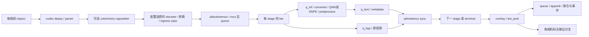

# Pipeline 拓扑与运行模式

> 代码核对基线：`b878219`；核对日期：2026-11-08。本文由外部架构草稿逐项对照本地源码后整理。
> `verified` = 当前源码/配置直接支持；`inferred` = 结构推断；`board-verified` = 当前版本有板端证据；`needs-confirmation` = 证据不足。本次只读代码，未新增 board-verified 结论。

## 1. 构图入口与模式（verified）

[TxtSnapshotLoader](../../src/config/TxtSnapshotLoader.cpp) → [PipelineOrchestrator](../../src/orchestrator/PipelineOrchestrator.cpp) → ExecutionPlan → [GstPipelineBuilder](../../src/pipeline/GstPipelineBuilder.cpp)。实际拓扑依赖快照、stage 分组、execution mode、CLI 与环境变量。

Builder 结构体中 `enable_yolo_stages=false`、`enable_annotated_rtsp=false` 是接口默认值；[main.cpp](../../main.cpp) 明确打开 YOLO stages，并在 `plan.annotated_media_config.enabled` 时打开标注输出。`kMultistreamBatch` 与 annotated_media 的组合在 main 中直接报错退出，不是所有能力可同时启用。

## 2. Time-mux / serial 主干（verified：源码连接；板端图 needs-confirmation）

`Build()` 按 time_mux_group 选择 stage；每个 stage 的推理与原视频 bypass 经 `qtimetamux` 配对。`q_inf/q_byp` 当前设非 leaky，不能从全局 latest 策略推断每个 queue 都丢旧帧。ROI 分类等细节依 stage 配置与 converter/postprocess 实现。

## 3. mux 与 demux（verified）

- timemux sink 是 request pad；每 sink 保存 latest buffer；scheduler 在线程中轮询就绪 slot。释放后重申请从 `[0,max_sinks)` 环形寻找空闲 slot，会复用已释放 ID，不会分配仍在使用的 slot。
- `fifo` 枚举虽已注册，源码链路仍保存/覆盖 latest_buffer，未实现独立 FIFO 路径，不能作为可用 FIFO 策略描述。
- demux sink 常驻，`src_%u` 是 request pads；每输出有 bounded queue 和 GstTask。插件默认 output-fps=10，但标注输出分支显式设置 0 以传递原 PTS；默认 queue-size=2。
- 实际 max-sinks/max-srcs 由 Builder 显式设置。属性声明与实例初始化默认值的差异见 [审核报告](REVIEW.md)。

## 4. 标注 RTSP 分支（verified）

`tee_post → q_demux → aiboxstreamdemux → 每相机 pre-encoder queue → encoder → parser → tee_webrtc → fakesink`；[AnnotatedRtspServer](../../src/media/AnnotatedRtspServer.cpp) 从已存在的编码输出构建 RTSP 发布支路。

Builder 可按 `AIBOX_WEBRTC_SPLITTER=camsplit` 使用 appsink/appsrc 拷贝式 splitter；公共启动脚本当前强制设置 `demux`。每相机 encoder/parser/payloader 由该相机 `input.encoding` 的 codec profile 选择，支持 H.264/H.265，不是固定 H.264。

正常标注路径每相机固定建立 encoder；诊断环境 `AIBOX_CAMSPLIT_FAKESINK` 等可改变/禁用输出，所以“配置 enabled=1”不等于每种环境均有可拉取视频。当前样例 bind 127.0.0.1:8555、mount `/cam/`、pre_queue_buffers=30；这些值不代表硬编码容量或外部 WebRTC/WHEP 已就绪。

## 5. 其它路径（verified：实现入口；运行结果 needs-confirmation）

- batch 路径由 `ShouldDispatchBatch` / `BuildBatchPipeline` 分派，包含 decode、qtibatch、推理、拆批、每相机 metamux，以及 BuildBatchCascadeStage 的后续级联，不走相同 time-mux 主干。
- `--record` 打开独立 mosaic compositor/encoder/matroskamux/filesink；不等同于每相机标注输出。录像关闭前需 EOS 收尾。
- 无标注模式仍有 FPS 等终端路径；可选 qtifaceinfer/诊断 taps 会进一步改变图。具体条件在 Builder 内，不能仅凭插件目录判定每次启用。

## 6. 当前快照与下一次板端验证

[PPE](../../config_snapshots/ppe_4cam/pipeline_ppe_4cam.txt) 与 [单阶段 Andon](../../config_snapshots/1stage_andon_4cam/pipeline_1stage_andon_4cam.txt) 的配置值见 [系统总览](system_overview.md)。四路 enabled、batch=1、max_group_size=6 与 max_streams=16 是不同维度。

下一次正式验证需记录源码、快照与 include 文件、CLI/env、插件/模型身份，保存对应 runtime DOT/structure/plan、关键 caps、各相机进展与输入输出，再对照本图。单个 `--dump-plan-only` 只是计划，不能替代实际运行图；每次产物按 tests 功能任务目录保存，由 [validation](../validation/README.md) 索引。
