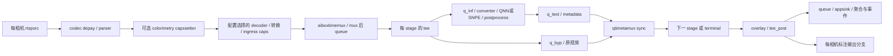

# Pipeline 拓扑与运行模式

> 源码核对日期 2026-11-25。基准为主工作区当前源码及配置。既有板端证据见 [验收索引](../validation/README.md)。

## 1. 构图入口与模式（verified）

[TxtSnapshotLoader](../../src/config/TxtSnapshotLoader.cpp) → [PipelineOrchestrator](../../src/orchestrator/PipelineOrchestrator.cpp) → ExecutionPlan → [GstPipelineBuilder](../../src/pipeline/GstPipelineBuilder.cpp)。实际拓扑依赖快照、stage 分组、execution mode、CLI 与环境变量。

Builder 结构体中 `enable_yolo_stages=false`、`enable_annotated_rtsp=false` 是接口默认值；[main.cpp](../../main.cpp) 明确打开 YOLO stages，并在 `plan.annotated_media_config.enabled` 时打开标注输出。`kMultistreamBatch` 与 annotated_media 的组合在 main 中直接报错退出，不是所有能力可同时启用。

## 2. Time-mux / serial 主干（verified：源码连接；板端图 needs-confirmation）

`Build()` 按 time_mux_group 选择 stage；每个 stage 的推理与原视频 bypass 经 `qtimetamux` 配对。`q_inf/q_byp` 当前设非 leaky，不能从全局 latest 策略推断每个 queue 都丢旧帧。ROI 分类等细节依 stage 配置与 converter/postprocess 实现。

## 3. mux 与 demux（verified）

- timemux sink 是 request pad；每 sink 保存 latest buffer；scheduler 在线程中轮询就绪 slot。释放后重申请从 `[0,max_sinks)` 环形寻找空闲 slot，会复用已释放 ID，不会分配仍在使用的 slot。
- `fifo` 枚举虽已注册，源码链路仍保存/覆盖 latest_buffer，未实现独立 FIFO 路径，不能作为可用 FIFO 策略描述。
- demux sink 常驻，`src_%u` 是 request pads；每输出有 bounded queue 和 GstTask。插件默认 output-fps=10，但标注输出分支显式设置 0 以传递原 PTS；默认 queue-size=2。
- 实际 max-sinks/max-srcs 由 Builder 显式设置。属性声明与实例初始化默认值的差异见 [审核报告](REVIEW.md)。

## 4. 标注 RTSP 分支（verified）

`tee_post → q_demux → aiboxstreamdemux → 每相机 pre-encoder queue → encoder → parser → tee_webrtc → fakesink`；[AnnotatedRtspServer](../../src/media/AnnotatedRtspServer.cpp) 从已存在的编码输出构建 RTSP 发布支路。

Builder 可按 `AIBOX_WEBRTC_SPLITTER=camsplit` 使用 appsink/appsrc 拷贝式 splitter；公共启动脚本当前强制设置 `demux`。每相机 encoder/parser/payloader 由该相机 `input.encoding` 的 codec profile 选择，支持 H.264/H.265，不是固定 H.264。

正常标注路径每相机固定建立 encoder；诊断环境 `AIBOX_CAMSPLIT_FAKESINK` 等可改变/禁用输出，所以“配置 enabled=1”不等于每种环境均有可拉取视频。当前样例 bind 127.0.0.1:8555、mount `/cam/`、pre_queue_buffers=30；这些值不代表硬编码容量或外部 WebRTC/WHEP 已就绪。

## 5. 其它路径（verified：实现入口；运行结果 needs-confirmation）

- batch 路径由 `ShouldDispatchBatch` / `BuildBatchPipeline` 分派，包含 decode、qtibatch、推理、拆批、每相机 metamux，以及 BuildBatchCascadeStage 的后续级联，不走相同 time-mux 主干。
- `--record` 打开独立 mosaic compositor/encoder/matroskamux/filesink；不等同于每相机标注输出。录像关闭前需 EOS 收尾。
- 无标注模式仍有 FPS 等终端路径；可选 qtifaceinfer/诊断 taps 会进一步改变图。具体条件在 Builder 内，不能仅凭插件目录判定每次启用。

## 6. 统一 RTSP 当前拓扑

[主工作区统一 JSON](../../config/unified_rtsp.json) 配置 8 路 CNN 和 4 路实时 SigLIP2，分配见 [系统总览](system_overview.md)。CNN 进程从渲染的 TXT 读取 PPE 与 Light 两个 profile，使用 `batch=1`。SigLIP2 每个相机进程持有自己的 RTSP 和 Image Encoder。cam-007 的两组词在同一进程中使用同帧图像向量，因此该路只开启一份实时图像链。当前统一入口校验每条 URL 在配置中只出现一次。[Supervisor](../../tools/rtsp_supervisor.py) · [场景主程序](../../src/siglip_worker/SceneMain.cpp)

TimeMux 选用 `canonical_raw`，主配置给出 1920×1080 NV12、progressive 的 group caps。插件比较可归一化差异时去掉 framerate 和 colorimetry，输出 canonical caps 声明可变帧率 `0/1`。这些协商规则允许同组输入的帧率不同，保留其他 caps 检查。输出吞吐与每路标注播放仍需用实际连接测量。[TimeMux 实现](../../plugins/aiboxtimemux/gstaiboxtimemux.cpp)

## 7. 历史快照与运行证据

四路 enabled、`batch=1`、`max_group_size=6` 与 `max_streams=16` 各自描述不同的运行参数。旧四路配置可在简化前的提交查阅，现行统一配置见上节。[历史 PPE 快照](https://github.com/kikiFrank/IoT_pipeline0918_main/blob/5e40fe10b2d3057f59f3b40e2403f7e6680cfee3/config_snapshots/ppe_4cam/pipeline_ppe_4cam.txt) · [历史单阶段 Andon 快照](https://github.com/kikiFrank/IoT_pipeline0918_main/blob/5e40fe10b2d3057f59f3b40e2403f7e6680cfee3/config_snapshots/1stage_andon_4cam/pipeline_1stage_andon_4cam.txt)

下一次正式验证需记录源码、快照与 include 文件、CLI/env、插件/模型身份，保存对应 runtime DOT/structure/plan、关键 caps、各相机进展与输入输出，再对照本图。单个 `--dump-plan-only` 只是计划，不能替代实际运行图；每次产物按 tests 功能任务目录保存，由 [validation](../validation/README.md) 索引。
