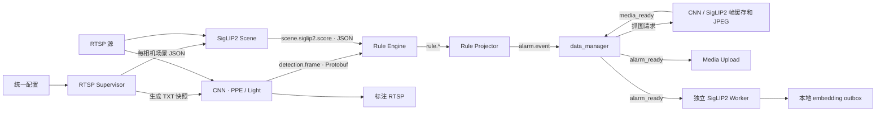

# 系统总览与微服务集成边界

> 源码核对日期 2026-11-25。基准为主工作区当前源码和配置。既有板端证据见 [验收索引](../validation/README.md)。

## 1. 可执行程序

| 程序 | 入口 | 职责 |
|---|---|---|
| `aibox_stream_pipeline_demo` | [main.cpp](../../main.cpp) | 将 TXT 快照编译为 ExecutionPlan 并构建 GStreamer 图。处理 CNN 推理、检测帧、标注 RTSP 和截图 |
| `aibox_siglip_scene` | [SceneMain.cpp](../../src/siglip_worker/SceneMain.cpp) | 连接一条实时 RTSP。启动时预先编码候选词，随后运行图像编码并发布场景分数 |
| `aibox_siglip_worker` | [Worker main.cpp](../../src/siglip_worker/main.cpp) | 运行独立的告警图片向量任务。消费 `alarm_ready`，读取告警与图片，生成本地 embedding outbox |

三个目标均由根 CMake 构建。统一 RTSP 入口启动一份 CNN 主进程及每个场景相机各一份 SigLIP2 Scene 进程。告警图片 Worker 有自己的进程和入口。[CMakeLists.txt](../../CMakeLists.txt) · [统一进程定义](../../tools/rtsp_supervisor.py)

## 2. 数据流

CNN 发布模型检测，整帧 PPE 由 Rule Engine 独立按相机和运行分组评估；业务告警由 Rule Projector 生成。C++ 的帧缓存和 JPEG 事件提供媒体材料，data_manager 负责告警与媒体关联。SigLIP2 Scene 输出每个场景的正负分数，告警阈值、连续样本数、恢复和冷却由 Rust 场景规则计算。告警图片 Worker 的本地向量供其独立流程使用。[数据契约](data_contracts.md) · [微服务接口及告警链路](../../../IoT_edge/aibox/arch_docs/Detection_Alarm_MediaUpload_Chain.md)

## 3. 主工作区默认 12 路

| 分配 | 逻辑相机 ID | RTSP 路径尾号，顺序对应 | 模型或场景 |
|---|---|---|---|
| PPE × 4 | cam-001、cam-002、cam-008、cam-012 | cam-016、cam-032、cam-026、cam-049 | YOLOX-S PPE 1123 W8A16 |
| Light × 4 | cam-003、cam-004、cam-005、cam-006 | cam-035、cam-022、cam-023、cam-024 | YOLOX-S Light 1121 W8A16 |
| SigLIP2 × 4 | cam-007、cam-009、cam-010、cam-011 | cam-021、cam-027、cam-041、cam-048 | 两组通道阻塞候选词、人员聚集、物料阻塞、工作站整顿 |

主工作区默认取 `config/unified_rtsp.json`。JSON 校验要求每路只选 CNN 或场景，RTSP URL 在同一份配置中不得重复。cam-007 的两组提示词共用该路图像编码结果。8 路 CNN 使用 QNN/HTP、`batch=1`，TimeMux 组上限 6；标注 RTSP 的配置地址为 `127.0.0.1:8555`，挂载前缀 `/cam/`。上限、分组和板端实测范围分别由配置、执行计划和验证日志给出。[统一配置](../../config/unified_rtsp.json) · [配置校验和进程构造](../../tools/rtsp_supervisor.py) · [拓扑](pipeline_topology.md) · [验收索引](../validation/README.md)
