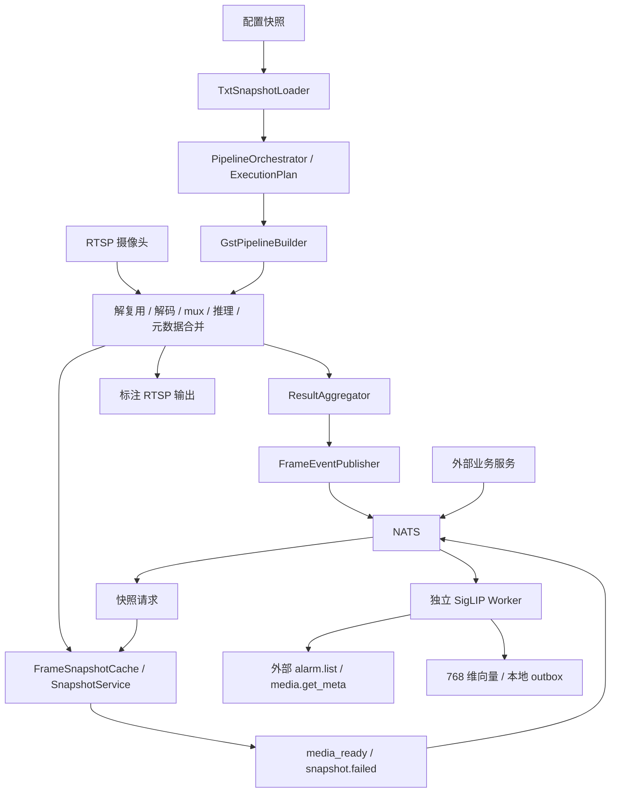

# 系统总览与微服务集成边界

> 代码核对基线：`b878219`；核对日期：2026-11-08。本文由外部架构草稿逐项对照本地源码后整理。
> `verified` = 当前源码/配置直接支持；`inferred` = 结构推断；`board-verified` = 当前版本有板端证据；`needs-confirmation` = 证据不足。本次只读代码，未新增 board-verified 结论。

## 1. 当前进程边界（verified）

根 [CMakeLists.txt](../../CMakeLists.txt) 定义两个可执行程序：

| 程序 | 入口 | 核心职责 |
|---|---|---|
| `aibox_stream_pipeline_demo` | [main.cpp](../../main.cpp) | TXT 配置→ExecutionPlan→GStreamer 图；视频推理、检测事件、标注 RTSP、图片缓存/快照、控制 RPC |
| `aibox_siglip_worker` | [Worker main](../../src/siglip_worker/main.cpp) | 订阅 alarm_ready，读取业务告警/图片信息，图片向量推理，结果写入本地 outbox |

两者是独立进程，由 Shell 生命周期脚本组合启动，不是一个进程内的两个普通模块。主进程的 NatsAdapter 与 Worker 的 SiglipNatsClient 也不是相同消息交付机制。

## 2. 主流程（verified 的构造/调用关系，实际运行需板端证据）

这张图表示源码职责关系，非所有场景都启用全部分支；GStreamer 具体连接见 [拓扑](pipeline_topology.md)，消息方向和载荷见 [契约](data_contracts.md)。外部业务内部流程属于 `inferred/needs-confirmation`，不是本仓库已验证的实现。

## 3. 与微服务的边界（verified：本仓库端点；needs-confirmation：对端实现）

Pipeline 发布 `detection.frame` 和 `event.stream.media_ready`，接收快照请求及控制 RPC。SigLIP Worker 消费 `event.datamgr.alarm_ready`，调用 `rpc.datamgr.alarm.list` 与 `rpc.datamgr.media.get_meta`。模型输出最终保存到本地 outbox，当前没有“向量已上传云端”的实现保证。

外部规则、业务告警生成、data_manager、媒体上传、云端存储、前端、MediaMTX/WebRTC/WHEP 属于系统集成范围，不能仅凭本仓库主题名和脚本名认定对端实现或验收通过。外部仓库是否为草稿提及的 `IoT_edge`、对应分支和部署版本，待用户审核时提供/确认。

## 4. 配置事实与容量边界（verified）

[PPE 四路快照](../../config_snapshots/ppe_4cam/pipeline_ppe_4cam.txt) 与 [单阶段 Andon 快照](../../config_snapshots/1stage_andon_4cam/pipeline_1stage_andon_4cam.txt) 均声明 `enabled_streams=4`、`max_streams=16`、`batch=1`、QNN/HTP、`soc_id=77`、`interval_ms=200`；timemux 组上限 6、等待 200 ms、latest/request/attach_meta；标注媒体启用，监听 127.0.0.1:8555，`/cam/`；缓存间隔 150 ms、总预算 536870912 B。

这些是配置值，不是全局默认值、实测吞吐或 16 路验收。硬件型号与 SoC/SDK 对应关系应结合实际板卡记录；当前主机单测及历史工程记录不替代当前 QCS9075 HTP/VPU 验收。
